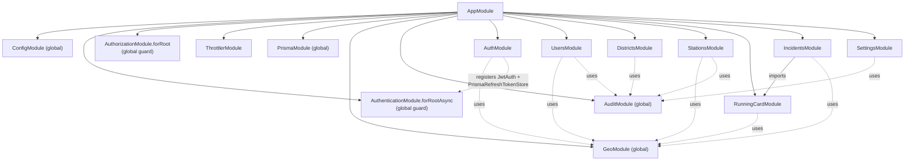

# Backend architecture

NestJS 12 application in `backend/`, compiled as ESM (`"type": "module"`, relative imports end in `.js`).

## Layers

| Layer | Where | Notes |
|---|---|---|
| Bootstrap | `src/main.ts`, `src/app.setup.ts` | `main.ts` imports `dotenv/config` first, builds the app, applies `configureApp()` (shared with e2e tests), mounts Swagger at `/api/docs`, listens on `PORT` (default 3000). |
| Root module | `src/app.module.ts` | Imports `ConfigModule` (global), `AuthenticationModule`, `AuthorizationModule`, `ThrottlerModule`, then feature modules. |
| Controllers | `src/*/**.controller.ts` | HTTP mapping, DTO validation, `@Can` / `@Public` declarations. Some controllers query Prisma directly (`districts`, `settings`, `running-card` uses a service plus `CityDirectory`). |
| Services | `src/*/**.service.ts` | Business rules, record-level authorization (`AuthorizationService.authorize`), transactions. |
| Pure logic | `running-card.logic.ts`, `geo/city-locator.ts`, `auth/area.ts` | No Nest or Prisma dependencies; unit-tested directly. |
| Data access | `src/prisma/prisma.service.ts` | `PrismaService extends PrismaClient`, using the `PrismaPg` driver adapter with `DATABASE_URL`. Generated client in `src/generated/prisma` (gitignored). |

There is no repository layer: services and some controllers use `PrismaService` directly.

## Modules and dependencies

Solid arrows are `imports`; dotted arrows are injections of providers from `@Global()` modules (`PrismaModule`, `GeoModule`, `AuditModule`) or global library modules. `AccessPolicy` is provided by `AuthModule` and is the only `@Policy()` class (`src/auth/access.policy.ts`).

| Module | Controllers | Providers |
|---|---|---|
| `auth` | `AuthController` | `AuthService`, `JwtAuth`, `PrismaRefreshTokenStore`, `AccessPolicy`, `UserLoader` |
| `users` | `UsersController` | `UsersService` |
| `districts` | `DistrictsController` | (none) |
| `stations` | `StationsController` | `StationsService` |
| `running-card` | `RunningCardController` | `RunningCardService` (exported) |
| `incidents` | `IncidentsController` | `IncidentsService` |
| `settings` | `SettingsController` | (none) |
| `audit` (global) | `AuditController` | `AuditService` (exported) |
| `geo` (global) | none | `CityDirectory` (exported) |
| `prisma` (global) | none | `PrismaService` (exported) |

## Cross-cutting behavior

- **Authentication.** The global guard from `@nestjs/authentication` runs `JwtAuth` (a `JwtBearerProvider`) on every route not marked `@Public()`. See [authentication](../security/authentication.md).
- **Authorization.** The global `AuthorizationGuard` denies by default. Each handler declares `@Can(AccessPolicy, '<ability>')` or `@Can.Anyone()`. See [authorization](../security/authorization.md).
- **Validation.** Global `ValidationPipe` with `whitelist: true, forbidNonWhitelisted: true, transform: true`. Unknown body fields cause a 400.
- **Rate limiting.** `ThrottlerModule.forRoot([{ ttl: 60_000, limit: 100 }])` is registered, but `ThrottlerGuard` is applied only to `POST /api/auth/login` (`@UseGuards(ThrottlerGuard)` plus `@Throttle` with `LOGIN_RATE_LIMIT`, default 10/min). There is no global `APP_GUARD`, so other routes are not rate-limited. See [gaps](../security/gaps.md).
- **Errors.** No custom exception filters or interceptors exist. Services throw Nest HTTP exceptions; `@nestjs/authorization` converts `AuthorizationError` to 401/403. See [API conventions](../api/README.md#errors).
- **Audit.** `AuditService.log()` is called explicitly from services (users, stations, barangay pins, settings). Incident actions are not audited.
- **Caching.** `CityDirectory` loads all cities and boundaries once per process; no other caching.

## Conventions observed in code

- Business rules that decide access live in `src/auth/area.ts` (office → area and dispatch city) and `src/auth/access.policy.ts` (abilities). Services call `authz.authorize(AccessPolicy, 'editCity' | 'dispatchIn', user, cityId)` after loading the record.
- Writes that must not race use conditional `updateMany` and check `count` (truck claiming, alarm raising, refresh-token use).
- Removal is soft for users (`deletedAt`), stations and trucks (`isActive`).
