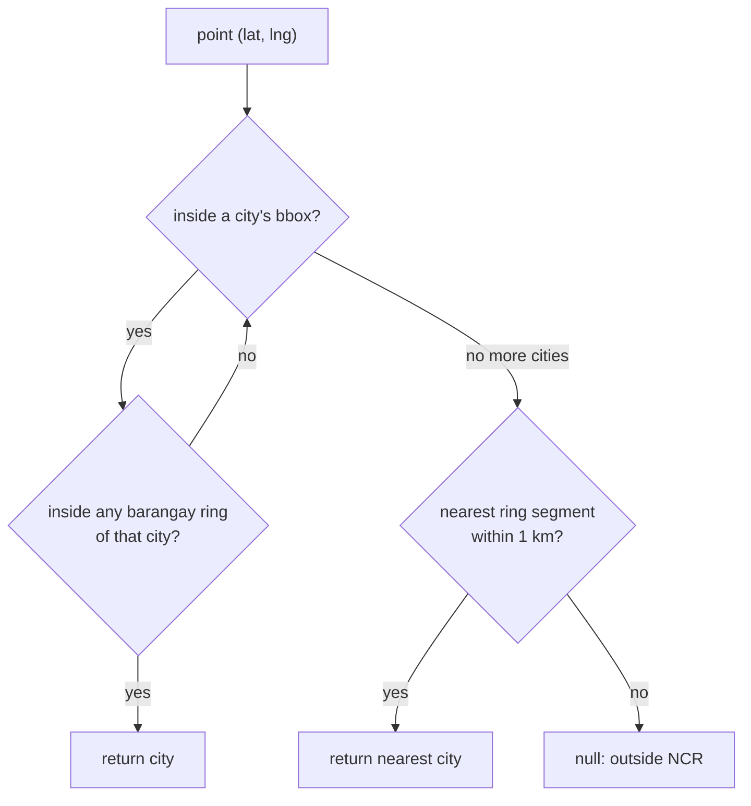
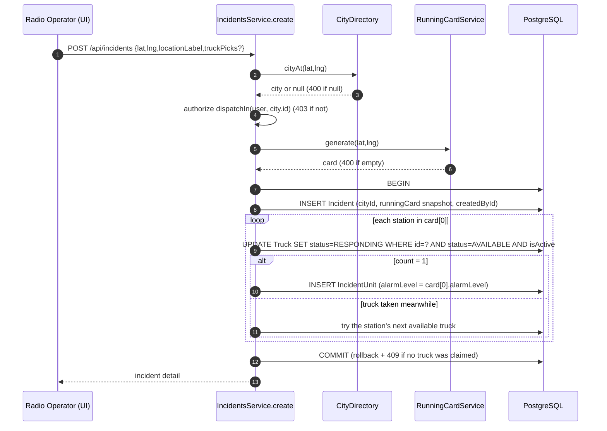
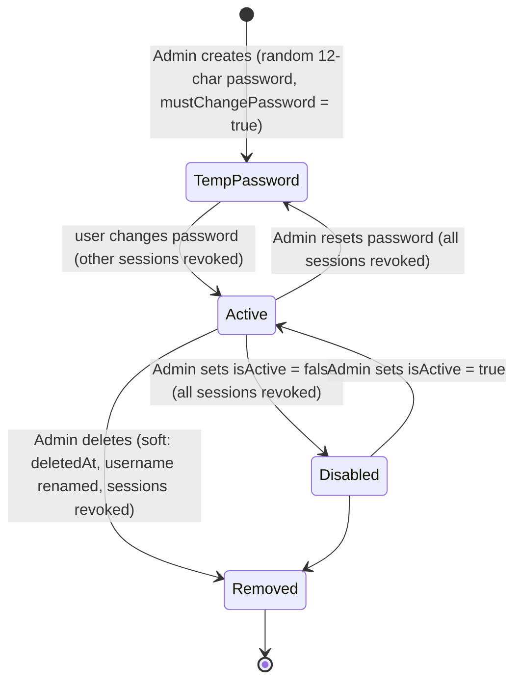

# Business processes

## 1. Building the running card

Source: `backend/src/running-card/running-card.service.ts`, `running-card.logic.ts`.

1. Load `Settings` (row id 1): `stationsPerAlarm`, `maxDistanceKm`, `alarmLevels`.
2. Load stations where `isActive = true`, `id NOT IN excludeStationIds`, and at least one truck has `isActive = true AND status = 'AVAILABLE'`. Each station includes only those available trucks, ordered by `id`.
3. `buildRunningCard()` computes the haversine distance (km) from the origin, drops stations beyond `maxDistanceKm`, sorts ascending, and slices into groups of `stationsPerAlarm`, one group per alarm level, in order.
4. Alarm levels with no stations are dropped, so a card can have fewer levels than `alarmLevels`.

The card is computed on every request; nothing is cached. Distance is straight-line, not road travel.

## 2. Which city a point is in

Source: `backend/src/geo/city-locator.ts`, `city-directory.service.ts`.

Boundaries are barangay outer rings grouped per city, stored in `City.boundary` and loaded once per process by `CityDirectory`. Used by the running card response (`city`), incident creation, and the seed backfill.

## 3. Dispatch (create incident)

Source: `backend/src/incidents/incidents.service.ts` (`create`, `dispatch`).

Rules:
- **One truck per station.** The operator's pick (`truckPicks[stationId]`) is tried first, then the station's other available trucks in `id` order.
- **No double booking.** The conditional update means a truck already `RESPONDING` is never claimed again. A station with no free truck is not on the card at all, so the next nearest station takes its place (covered by `test/incidents.e2e-spec.ts`, "never sends a truck that is already on another incident").
- The full card at dispatch time is stored as JSON in `Incident.runningCard`.

## 4. Raise alarm

Source: `incidents.service.ts` (`nextAlarm`, `raise`).

1. Load the open incident (404 if missing, 400 if closed); authorize `dispatchIn(user, incident.cityId)`.
2. `nextAlarm()`: next level name = `alarmLevels[alarmIndex + 1]` (null → 400 "already at the highest alarm level"). Recompute the card from the incident location, excluding stations already on the incident; the first group becomes the next alarm.
3. In a transaction: `UPDATE Incident SET alarmIndex = alarmIndex + 1 WHERE id AND status = OPEN AND alarmIndex = <value read in step 2>`. If 0 rows → 409 (someone else raised it). Then claim trucks as in dispatch (409 if none).

`GET /api/incidents/:id/next-alarm` returns the same preview without changing anything.

## 5. Close incident

Source: `incidents.service.ts` (`close`).

One transaction:
1. Trucks of unreleased units with `status = RESPONDING` → `AVAILABLE`. Trucks Operations set to `OUT_OF_SERVICE` meanwhile keep that status.
2. All units with `releasedAt = null` get `releasedAt = now()`.
3. Incident → `CLOSED`, `closedAt`, `closedById`.

Units are released only when the whole incident closes; there is no per-unit release endpoint.

## 6. Account lifecycle

Source: `backend/src/users/users.service.ts`, `auth/auth.service.ts`.

While `mustChangePassword` is true, `AccessPolicy.before()` denies every `@Can(...)` route; only `@Can.Anyone()` routes (`/auth/me`, `/auth/change-password`) and public routes work.

## 7. Barangay pin

Source: `backend/src/districts/districts.controller.ts`, `frontend/src/components/LocationSearch.jsx`.

1. The user picks District → City → Barangay in the UI.
2. If the barangay has `lat/lng`, the UI uses it.
3. Otherwise the UI geocodes `"<barangay>, <city>, Metro Manila, Philippines"` with Google and sends `PUT /api/barangays/:id/location`. When the stored pin is null, any signed-in user may set it, and this is **not** audit-logged.
4. Overwriting an existing pin requires `editCity` on the barangay's city and is audit-logged with old and new values.
