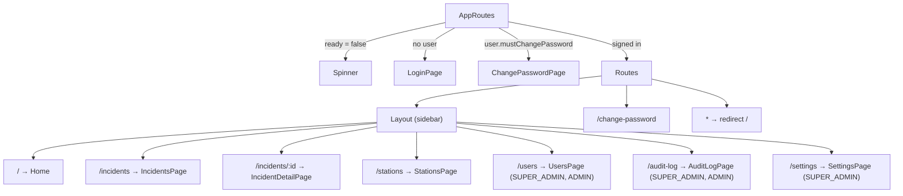

# Frontend architecture

React 19 single-page app in `frontend/`, built with Vite. JavaScript (JSX), no TypeScript. Imports use the `@/` alias for `src/` (`vite.config.js`, `jsconfig.json`).

## Structure

| Path | Contents |
|---|---|
| `src/main.jsx` | Mounts `<App />` in `StrictMode`; imports `index.css`. |
| `src/App.jsx` | `BrowserRouter` → `AuthProvider` → Google `APIProvider` (`VITE_GOOGLE_API`) → `TooltipProvider` → routes + `Toaster`. |
| `src/api/client.js` | `api(path, options)`, `refreshSession()`, `ApiError`, in-memory access token. |
| `src/auth/AuthContext.jsx` | `AuthProvider`, `useAuth()`, `ROLE_LABELS`. |
| `src/auth/permissions.js` | `OFFICE_LEVELS`, `OFFICE_LABELS`, `canDispatchIn`, `canDispatchAnywhere`, `canEditCity`, `officeName`. Mirrors backend rules for showing UI only. |
| `src/components/` | App components: `Layout` (sidebar + `NAV`), `Home` (running card page), `LocationSearch`, `MapComponent`, `Card` (running card), `AuthShell`, `Page`, `Field`, `SimpleSelect`, `ConfirmDialog`, `StatusBadge`. |
| `src/components/ui/` | shadcn/ui components generated by the shadcn CLI (`components.json`); excluded from ESLint. |
| `src/pages/` | `LoginPage`, `ChangePasswordPage`, `IncidentsPage`, `IncidentDetailPage`, `StationsPage`, `UsersPage`, `SettingsPage`, `AuditLogPage`. |
| `src/variables/variables.js` | `NCR_BOUNDS`, `parseCoordinates()` (tested in `variables.test.js`). |
| `src/labels.js` | Display labels for truck type, ownership and status. |
| `src/lib/utils.js`, `src/hooks/use-mobile.js` | shadcn helpers (`cn`, mobile breakpoint hook). |
| `src/index.css` | Tailwind v4 import and theme tokens (BFP red `--primary`, `--gold` accent, light and `.dark` values). |

The running card page component lives in `src/components/Home.jsx`, not `src/pages/`.

## Routing and access

Routes are generated from `NAV` in `src/components/Layout.jsx`, filtered by `user.role`, so pages a role may not use are not routed at all. Finer rules (dispatch city, editable cities) are applied inside pages with the helpers in `src/auth/permissions.js`. The backend enforces the real rules.

## State management

- **No global store.** Session state is React context (`AuthContext`). Pages keep their own `useState` and load data in `useEffect` through `api()`.
- **Access token** lives in a module variable in `api/client.js`, never in `localStorage`. The refresh token is an httpOnly cookie the browser sends only to `/api/auth/*`.
- **Session restore.** On mount, `AuthProvider` calls `refreshSession()`. Success sets `user`; failure leaves the user signed out. `ready` gates rendering.
- **Persistence.** None, except that the generated shadcn `components/ui/sidebar.jsx` writes a `sidebar_state` cookie when the sidebar is toggled. Nothing in the app reads it back.

## API client behavior (`src/api/client.js`)

1. Sends `fetch('/api' + path)` with `credentials: 'same-origin'`, a JSON body, and `Authorization: Bearer <token>` when a token is set.
2. On HTTP 401 for any path not starting with `/auth/`, calls `refreshSession()` once and retries the original request.
3. Concurrent callers share one in-flight refresh (`refreshing` promise), because each refresh token can be used only once.
4. If refresh fails, clears the token, calls the signed-out handler (sets `user` to null), and throws `ApiError(401)`.
5. Non-2xx responses throw `ApiError(status, body)`; `message` joins Nest validation messages.

## Google Maps integration

| Feature | Library / API | Where |
|---|---|---|
| Map, draggable pin, click to place | `@vis.gl/react-google-maps` `Map`, `AdvancedMarker`, `useMap` (Maps JavaScript API, fixed `mapId`) | `components/MapComponent.jsx` |
| Address/landmark suggestions | `places.AutocompleteSuggestion.fetchAutocompleteSuggestions` (Places API (New)), session tokens, `locationRestriction: NCR_BOUNDS`, `includedRegionCodes: ['ph']` | `components/LocationSearch.jsx` (`PlaceSearch`) |
| Barangay first-time location | `geocoding.Geocoder().geocode` (Geocoding API), result saved with `PUT /api/barangays/:id/location` | `components/LocationSearch.jsx` |

## UI kit and styling

- shadcn/ui (style `new-york`, JSX, lucide icons) on Radix primitives; Tailwind v4 via `@tailwindcss/vite`; `tw-animate-css`.
- Theme tokens in `src/index.css`; colors are referenced through tokens (`bg-primary`, `text-muted-foreground`, `bg-gold`). District colors come from the database (`FireDistrict.color`).
- Responsive: collapsible sidebar (a sheet on mobile); several pages render cards below the `md` breakpoint and tables above it.
- Toasts (`sonner`) report action results; inline `Alert` shows form errors.

## UI conventions (2026-11 refresh)

- **Office names** (`officeName`, `districtName` in `src/auth/permissions.js`): "Caloocan City Fire Station", "Pateros Municipal Fire Station", "Fire District II (CAMANAVA)", "Manila Fire District", "Quezon City Fire District", "Regional Headquarters".
- **Alarm scale** (`alarmTone` in `src/lib/alarm.js`, `AlarmBadge` in `src/components/Alarm.jsx`): BFP red for 1st–5th Alarm, charcoal for task forces, black with a gold ring for the general alarm. Used on running cards, incident badges, the incident alarm strip, the time log and notifications.
- **Typography:** Inter for text; Barlow Condensed (`font-condensed`) for call signs, alarm levels and figures.
- **Incident page:** alarm strip with live elapsed time (`Elapsed`), map with the fire and one pin per responding station (district colour), units with their city, and a time log of dispatch / raises / close.
- **Map pins** (`MapComponent.jsx`): the fire is a red pin with a gold flame; stations are pins in their district colour with a fire-truck icon (`FireTruckIcon`, drawn in Lucide's style since Lucide has none). The station form's pin is a station (`kind="station"`).
- **Truck types offered:** Engine / Pumper, Water Tanker, Aerial Ladder, Other (`NEW_TRUCK_TYPES` in `labels.js`, mirrored by `stations.dto.ts`); Ambulance/Rescue labels stay for older records.
- **Night mode:** user menu toggle; `dark` class on `<html>`, remembered in `localStorage` (`rcs-theme`), defaults to the system setting (`src/lib/theme.js`). The Google map follows it.
- **Live updates:** `NotificationsProvider` exposes `last`, `version`, `openIncidents` (sidebar bubble on Incidents), `viewIncident(id)`; the incident page and incidents list reload on live events. Urgent dispatches are also announced through an `aria-live="assertive"` region.
- **Home page** is the first page the role may open: Running Card for Radio Operators and Super Admin, Incidents for others.
- All clickable elements get `cursor: pointer` (`index.css` base layer).
