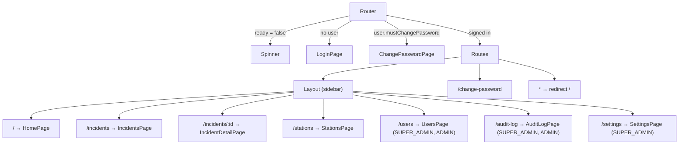

# Frontend architecture

React 19 single-page app in `frontend/`, built with Vite. JavaScript (JSX), no TypeScript. Imports use the `@/` alias for `src/` (`vite.config.js`, `jsconfig.json`).

## Structure

Same layout as the team's FIIS frontend: thin pages, feature components, one hook per query or mutation, one service per API area.

| Path | Contents |
|---|---|
| `src/main.jsx` | Mounts `<App />` inside `QueryClientProvider` and `StrictMode`; imports `index.css`. |
| `components/app/` | `App.jsx` (`BrowserRouter` → `AuthProvider` → Google `APIProvider` → `TooltipProvider` → `Router` + `Toaster`), `Router.jsx` (routes from `NAV`). `providers/`: `AuthProvider`, `NotificationsProvider` (SSE loop, unread count, alert toast + beep). |
| `components/layout/` | `Layout` (signed-in shell), `Navbar`, `NotificationBell`, `AppSidebar/` (`AppSidebar`, `Brand`, `NavItems`, `UserMenu`). |
| `components/common/` | Shared parts: `Page`, `Field`, `SimpleSelect`, `ConfirmDialog`, `ListSkeleton`, `IconAction`, `AlarmBadge`, `Elapsed`, `TruckStatusBadge`, `MapComponent`. |
| `components/features/<feature>/` | Feature parts, one component per file: `auth`, `runningCard` (`RunningCard`, `DispatchBar`, `DispatchDialog`, `locationSearch/`), `incidents` (`list/`, `detail/`), `deployments` (`list/`, `detail/`, form and truck picker), `notifications`, `users` (`table/`, dialogs), `stations`, `statistics` (`charts/`), `settings`, `auditLog`. Dialog forms own their form state and call their mutation hooks. |
| `components/ui/` | shadcn/ui components generated by the shadcn CLI (`components.json`); excluded from ESLint. Never hand-edit. |
| `pages/` | One per route (`HomePage` is the running card). Pages hold only page state (filters, selection, which dialog is open) and compose features. |
| `hooks/<domain>/` | `useGetX` = one `useQuery`; `useAddX` / `useEditX` / … = one `useMutation` that invalidates its keys and shows its success toast. Button actions toast their errors in the hook; dialog forms catch `mutateAsync` and show the error inline. Also `auth/useAuth`, `notifications/useNotifications` (each holds its React context), `settings/useAlarmIndex`, `useTheme`, shadcn's `use-mobile`. |
| `service/` | `client.js` (`api()`, `download()`, `stream()`, `refreshSession()`, `ApiError`, in-memory access token), `queryClient.js`, and `<domain>.service.js`: one plain function per endpoint. Only services call `api()`. |
| `constants/` | `links` (`NAV`), `roles`, `office`, `truck`, `audit`, `notifications`, `statistics`, `map` (`NCR_BOUNDS`). |
| `utils/` | Pure helpers: `permissions` (mirrors backend rules, UI only), `alarm`, `stats`, `person`, `dateTime`, `theme`, `validation` (`formErrors`), `audit`, `coordinates`, and the form mappers `userForm`, `stationForm`, `settingsForm`, `passwordErrors`. Tests (`*.test.js`) sit next to their file; files with tests import with relative paths (`node --test` has no `@/` alias). |
| `lib/utils.js` | shadcn's `cn` helper (shadcn's `components.json` points there). |
| `src/index.css` | Tailwind v4 import and theme tokens (BFP red `--primary`, `--gold` accent, light and `.dark` values). |

## Routing and access

Routes are generated from `NAV` in `src/constants/links.js` (`components/app/Router.jsx`), filtered by `user.role`, so pages a role may not use are not routed at all. Finer rules (dispatch city, editable cities) are applied inside pages with the helpers in `src/utils/permissions.js`. The backend enforces the real rules.

## State management

- **Server data goes through TanStack Query** (`@tanstack/react-query`, client in `src/service/queryClient.js`); every query and mutation lives in a `hooks/<domain>/` file and calls a `service/` function. Session state is React context (`AuthProvider` / `useAuth`); local UI state stays in `useState`. Forms stay plain `useState` + `formErrors()` with the shared Zod schemas (no form library: the forms are small).
  - Keys: `["incidents", status]`, `["incident", id]` (+ `"next-alarm"`), `["users"]`, `["districts"]` (`useGetDistricts`, never stale), `["stations", districtId]`, `["audit", entity]` (infinite), `["settings"]` (`useGetSettings`; also gives alarm badge colours), `["statistics", query]`, `["running-card", lat, lng]` (`staleTime: 0`), `["barangays", cityId]`, `["deployments", status]`, `["deployment", id]`.
  - Defaults: 30 s `staleTime`, one retry for network/5xx only, a failed load toasts once (`meta: { silent: true }` opts out).
  - Mutation hooks invalidate their keys on success. A live notification invalidates `["incidents"]` and `["incident", id]` (or `["deployments"]` and `["deployment", id]`), and `["stations"]`. The notification feed itself stays hand-merged so its unread dots survive refreshes.
  - Signing out calls `queryClient.clear()` so the next account never sees cached data.
  - While a list loads it shows `components/common/ListSkeleton.jsx`, never its empty state.
- **Access token** lives in a module variable in `service/client.js`, never in `localStorage`. The refresh token is an httpOnly cookie the browser sends only to `/api/auth/*`.
- **Session restore.** On mount, `AuthProvider` calls `refreshSession()`. Success sets `user`; failure leaves the user signed out. `ready` gates rendering.
- **Persistence.** None, except that the generated shadcn `components/ui/sidebar.jsx` writes a `sidebar_state` cookie when the sidebar is toggled. Nothing in the app reads it back.

## API client behavior (`src/service/client.js`)

1. Sends `fetch('/api' + path)` with `credentials: 'same-origin'`, a JSON body, and `Authorization: Bearer <token>` when a token is set.
2. On HTTP 401 for any path not starting with `/auth/`, calls `refreshSession()` once and retries the original request.
3. Concurrent callers share one in-flight refresh (`refreshing` promise), because each refresh token can be used only once.
4. If refresh fails, clears the token, calls the signed-out handler (sets `user` to null), and throws `ApiError(401)`.
5. Non-2xx responses throw `ApiError(status, body)`; `message` joins Nest validation messages.

## Google Maps integration

| Feature | Library / API | Where |
|---|---|---|
| Map, draggable pin, click to place | `@vis.gl/react-google-maps` `Map`, `AdvancedMarker`, `useMap` (Maps JavaScript API, fixed `mapId`) | `components/MapComponent.jsx` |
| Address/landmark suggestions | `places.AutocompleteSuggestion.fetchAutocompleteSuggestions` (Places API (New)), session tokens, `locationRestriction: NCR_BOUNDS`, `includedRegionCodes: ['ph']` | `components/LocationSearch.jsx` (`PlaceSearch.jsx`) |
| Barangay first-time location | `geocoding.Geocoder().geocode` (Geocoding API), result saved with `PUT /api/barangays/:id/location` | `components/features/runningCard/locationSearch/LocationSearch.jsx` |

## UI kit and styling

- shadcn/ui (style `new-york`, JSX, lucide icons) on Radix primitives; Tailwind v4 via `@tailwindcss/vite`; `tw-animate-css`.
- Theme tokens in `src/index.css`; colors are referenced through tokens (`bg-primary`, `text-muted-foreground`, `bg-gold`). District colors come from the database (`FireDistrict.color`).
- Responsive: collapsible sidebar (a sheet on mobile); several pages render cards below the `md` breakpoint and tables above it.
- Toasts (`sonner`) report action results; inline `Alert` shows form errors.

## UI conventions (2026-11 refresh)

- **Office names** (`officeName`, `districtName` in `src/utils/permissions.js`): "Caloocan City Fire Station", "Pateros Municipal Fire Station", "Fire District II (CAMANAVA)", "Manila Fire District", "Quezon City Fire District", "Regional Headquarters".
- **Alarm scale** (`alarmTone` in `src/utils/alarm.js`, `components/common/AlarmBadge.jsx`): BFP red for 1st–5th Alarm, charcoal for task forces, black with a gold ring for the general alarm. Used on running cards, incident badges, the incident alarm strip, the time log and notifications.
- **Typography:** Inter for text; Barlow Condensed (`font-condensed`) for call signs, alarm levels and figures.
- **Incident page:** alarm strip with live elapsed time (`Elapsed`), map with the fire and one pin per responding station (district colour), units with their city, and a time log of dispatch / raises / close.
- **Branding** (`frontend/public/`): `logo.webp` (BFP seal, Bagong Pilipinas, DILG–BFP NCR badge; login page and open sidebar), `logo-badge.webp` (collapsed sidebar), `favicon-32.png`, `favicon-64.png`, `apple-touch-icon.png` (browser tab, home screen). They were rendered from the supplied `main.svg` / `icon.svg`, which are 2.0 MB and 3.7 MB of embedded bitmaps, at twice their display size (≈ 60 KB in total). To change the logo, re-render from the new source at the same sizes. The logo is shown on the page background as is, without a plate.
- **Sign-in pages** (`AuthShell.jsx`, used by login and change password): the form on the light side (small logo top-left, pill inputs with icons, show/hide password on login); a deep BFP-crimson panel on the other side with a flowing two-layer curved edge, the app name, and a BFP fire truck photo at low opacity (`public/login-truck.webp`) tinted into the crimson and faded towards the curve. Phones show the panel as a band above the form.
- **Login photo licence:** "MAN TGM 18.250 Rosenbauer Fire Truck (2)" by Captainmorlypogi1959, [Wikimedia Commons](https://commons.wikimedia.org/wiki/File:MAN_TGM_18.250_Rosenbauer_Fire_Truck_(2).jpg), **CC BY-SA 4.0**. The licence requires the credit shown in the panel's corner (`PHOTO_CREDIT` in `AuthShell.jsx`); keep it whenever the photo is shown. The resized copy in `public/` stays under CC BY-SA 4.0.
- **Users page filters** (`components/features/users/UserFilters.jsx`, `utils/userFilters.js`): search by name or account number, office (Regional Headquarters or a fire district) and, for multi-city districts, city. Filtering is in the browser over the loaded list.
- **Saving state:** form dialogs use `components/common/SubmitButton.jsx`: the Save button spins and is disabled, and the dialog can't be closed, until the request and the list reload finish.
- **Form validation:** forms check the request body against the shared Zod schema (`backend/src/shared/validation.ts`, imported as `@shared/validation`; `formErrors()` in `src/utils/validation.js`) when Save is pressed, show each message under its field (`Field` `error` prop, which marks the control `aria-invalid`), and update the messages as the user edits. Invalid forms send nothing; server-only errors (duplicates, permissions) still show at the top. Vite resolves `zod` from the frontend (`resolve.dedupe`).
- **Statistics page** (`src/pages/StatisticsPage.jsx` + `components/features/statistics/`, `/statistics`, all roles): filters in the URL (presets 7/30/90 days or this year, custom dates, district → city), **Download CSV** (`download()` in `src/service/client.js`). Charts are plain HTML/CSS in `src/components/features/statistics/charts/` (`BarList`, `Columns`, `HeatGrid`, `StatTile`, `ChartCard` with a Table toggle; `IncidentDotsMap` for fire locations as translucent dots, since Google's heat-map layer is gone). Built with the dataviz skill: one BFP-red hue, `--chart-bar` for bars and the `--chart-1..5` ramp for the heat grid, separate light and dark steps validated with its `validateOrdinal` (lightness monotone, steps ≥ 0.06 apart, palest step ≥ 2:1 on the card); tooltips on hover and keyboard focus; values in text colours.
- **Map pins** (`MapComponent.jsx`): the fire is a red pin with a gold flame; stations are pins in their district colour with a fire-truck icon (`FireTruckIcon`, drawn in Lucide's style since Lucide has none). The station form's pin is a station (`kind="station"`).
- **Truck types offered:** Mini Pumper, Engine, Tanker, Ladder, Rescue Truck, CSSR Truck, Ambulance (`TRUCK_TYPES` / `SPECIAL_TRUCK_TYPES` in the shared `@shared/validation`; labels in `constants/truck.js`). Special units are sent from `RequestSpecialUnit.jsx` on the incident page (`useGetSpecialUnits`, `useRequestSpecialUnit`).
- **Night mode:** user menu toggle; `dark` class on `<html>`, remembered in `localStorage` (`rcs-theme`), defaults to the system setting (`src/utils/theme.js`). The Google map follows it.
- **Live updates:** `NotificationsProvider` exposes `last`, `version`, `openIncidents` (sidebar bubble on Incidents), `viewIncident(id)`; the incident page and incidents list reload on live events. Urgent dispatches are also announced through an `aria-live="assertive"` region.
- **Home page** is the first page the role may open: Running Card for Radio Operators and Super Admin, Incidents for others.
- All clickable elements get `cursor: pointer` (`index.css` base layer).
- **About page** (`/about`, `pages/AboutPage.jsx` + `components/features/about/`): every role, and readable signed out (the router shows it instead of the sign-in page for that path; linked from the sign-in page). Credit and support text live in `constants/about.js`. Live alarm levels come from `useGetSettings` only when signed in. Version, build date and commit come from the `__BUILD__` define in `vite.config.js` (commit from `GIT_COMMIT`, else `git rev-parse`; the Docker build passes `GIT_COMMIT` as a build arg).

## Design system (redesign, 2026-11)

- **Look:** charcoal shell (sidebar and top bar, tokens `--shell*`, the same in both themes) around a light, high-contrast workspace; dark mode kept. BFP red (`--primary`) is the brand and the colour of critical actions (Dispatch, Raise alarm).
- **Status language** (`constants/status.js`, `common/StatusBadge.jsx`): success = available / done, warning = responding / pending, danger = active incident, info = planned deployment, neutral = closed, muted = out of service / ended. Each tone has a fill (`--success` …) and an AA text tone (`--success-foreground` …, at least 5:1 on its tint, checked for both themes). Trucks (`TRUCK_STATUS[s].tone`), incidents (`INCIDENT_STATUS`) and deployments (`DEPLOYMENT_STATUS`) all map onto it. Alarm levels keep their own escalation scale (`utils/alarm.js`).
- **Type:** Inter for the UI; `font-data` (Barlow Condensed + tabular figures) for call signs, alarm levels, times and counts; `text-label` for small uppercase labels.
- **Building blocks** (`components/common/`): `Panel` (bordered section with a header bar; the default container), `Toolbar`, `DataTable`, `EmptyState`, `ErrorState`, `KeyValue`, `StatTile`, `StatusBadge`. `components/ui/` stays generated; its house style (radius, flat cards, dense table heads and cells) comes from `data-slot` rules at the end of `index.css`.
- **Shell:** the top bar holds the page's only `h1` (the nav label, or the detail page's own title through `hooks/layout/usePageTitle.js` with a breadcrumb back to its list), the live-link status (`linkStatus` from `NotificationsProvider`: connecting / live / offline), a Philippine-time clock, notifications and the account menu.
- **Running Card:** a full-height split on wide screens (map with the search and By district picker over it; dispatch panel with the location, what is in range, the card and the Dispatch button pinned at its foot); one column on phones with the button pinned to the bottom.

