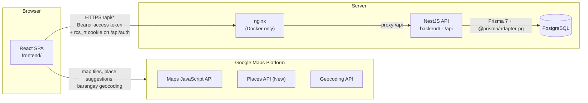
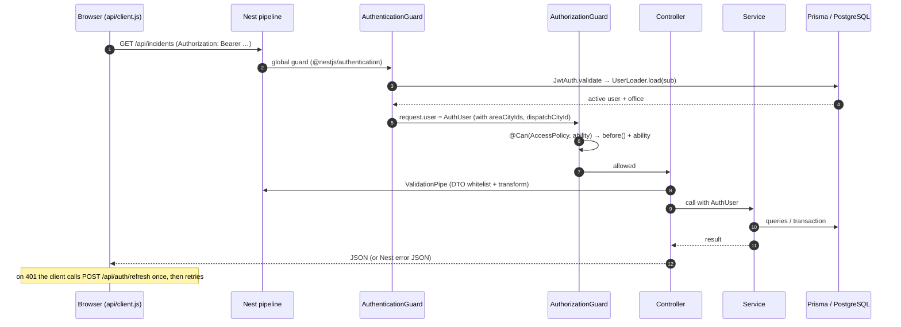
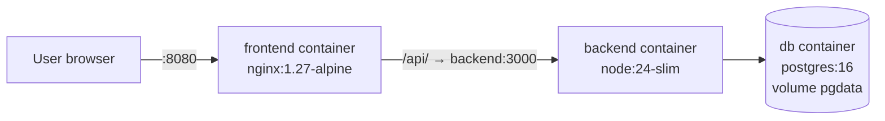

# Architecture overview

## System

A single-page React application talks to a NestJS REST API, which stores everything in PostgreSQL through Prisma. Google Maps Platform is used only from the browser.

- In development, Vite serves the SPA and proxies `/api` to the backend (`frontend/vite.config.js`, target `API_URL` or `http://localhost:3000`). Without nginx, browser and API share one origin.
- In Docker, nginx serves the built SPA and proxies `/api/` to `backend:3000` (`frontend/nginx.conf`, `docker-compose.yml`). **Needs Verification:** the Docker setup has not been run in the environment where this documentation was written.
- The backend never calls Google. Which city a point is in is computed on the server from bundled boundary data (see [geo module](../modules/geo.md)).

## Technology stack

| Layer | Technology (version range from `package.json`) |
|---|---|
| Frontend | React `^19.1.10`, React Router `^7.18.5`, Vite `^6.0.1`, Tailwind CSS `^4.3.5`, shadcn/ui (Radix `radix-ui ^1.8.1`, `cmdk`, `lucide-react`, `sonner`), `@vis.gl/react-google-maps ^1.4.2` |
| Backend | NestJS `^12.0.1` (ESM), `@nestjs/authentication ^0.1.5`, `@nestjs/authorization ^0.1.3`, `@nestjs/throttler ^6.7.1`, `@nestjs/swagger ^12.1.1`, `@nestjs/config`, class-validator / class-transformer, cookie-parser |
| Data | PostgreSQL (16 in `docker-compose.yml`), Prisma `^7.10.1` with `@prisma/adapter-pg` |
| Tests | Vitest `^4.1.2` + supertest (backend), `node --test` (frontend) |
| Lint | oxlint (backend), ESLint 9 flat config (frontend) |

## Request flow

The global pipeline is configured in `backend/src/app.setup.ts`: global prefix `api`, `cookie-parser`, a global `ValidationPipe({ whitelist, forbidNonWhitelisted, transform })`, and CORS for `FRONTEND_ORIGIN` with credentials. Guard order (authentication before authorization) comes from the import order in `backend/src/app.module.ts`.

## Main components and how they interact

| Component | Role | Talks to |
|---|---|---|
| `frontend/src/api/client.js` | fetch wrapper; in-memory access token; single shared refresh | `/api/*` |
| `frontend/src/auth/AuthContext.jsx` | signed-in user state; restores the session on load | client.js |
| `backend/src/auth` | sign-in, token rotation, `AccessPolicy`, user loading | users, geo, prisma |
| `backend/src/geo` | `CityDirectory`: cities + point-in-city lookup | prisma |
| `backend/src/running-card` | builds the card from live truck status | prisma |
| `backend/src/incidents` | dispatch / raise / close; truck claiming | running-card, geo, prisma, authorization |
| `backend/src/stations` | stations and trucks CRUD | geo, audit, authorization |
| `backend/src/users` | account management | geo, audit, authentication |
| `backend/src/audit` | change log | prisma |

See [backend architecture](backend.md) and [frontend architecture](frontend.md) for details.

## Deployment topology (Docker)

The backend container runs `prisma migrate deploy && prisma db seed && node dist/main.js` on every start (`backend/Dockerfile`). See [deployment](../development/deployment.md).
