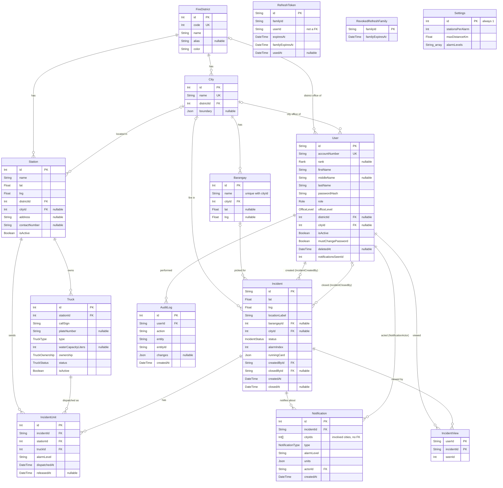

# Entity relationship diagram

Generated from `backend/prisma/schema.prisma`. Only relations declared in the schema are drawn. `RefreshToken`, `RevokedRefreshFamily` and `Settings` have no declared relations; `RefreshToken.userId` holds a user id but is **not** a foreign key.

Note: `IncidentUnit.alarmLevel` and `Incident.alarmIndex` refer to `Settings.alarmLevels` by name and by position. That link is not a database relation.
