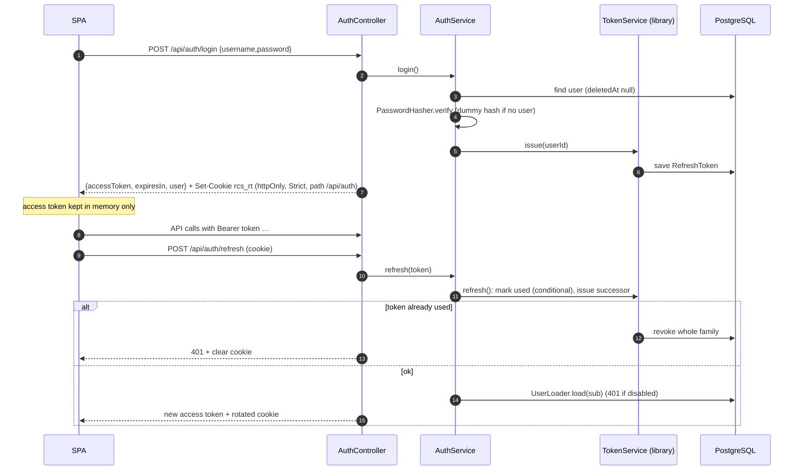

# Authentication

Implemented with `@nestjs/authentication` `^0.1.5` (a pre-1.0, first-party NestJS package), configured in `backend/src/app.module.ts` and `backend/src/auth/`.

## Configuration

| Setting | Value | Source |
|---|---|---|
| Access token | JWT signed with `JWT_SECRET`, issuer `bfp-ncr-rcs`, audience `rcs-web`, TTL **15 min** | `app.module.ts` |
| Signing algorithm | library default (**Needs Verification**; `alg` not set explicitly) | |
| Refresh token | opaque, TTL **7 d**, family absolute TTL **30 d**, rotated on every use | `app.module.ts` |
| Refresh store | `PrismaRefreshTokenStore` (`RefreshToken`, `RevokedRefreshFamily` tables) | `auth/prisma-refresh-token.store.ts` |
| Credential provider | `JwtAuth extends JwtBearerProvider` (realm `rcs`) | `auth/jwt-auth.provider.ts` |
| Global guard | registered by `AuthenticationModule`; every route needs a valid token unless `@Public()` | library |

The library stores only hashes of refresh tokens, per its documentation (**Needs Verification**: the store receives `RefreshTokenRecord` objects; whether `id` is derived from the secret is internal to the library).

## Flows

- **Every request reloads the user.** `JwtAuth.validate({ sub })` calls `UserLoader.load()`, which returns null for inactive or soft-deleted users (→ 401). Disabling, removing or changing an office takes effect on the next request even with an unexpired access token.
- **Reuse detection.** `markRefreshTokenUsed` is a conditional `updateMany(where usedAt = null)`, so only one concurrent refresh wins. Presenting a spent token revokes the family (library behavior; covered by `test/auth.e2e-spec.ts`).
- **Logout** revokes the cookie's family and clears the cookie.
- **Revoke all** (`TokenService.revokeAll`) runs on password change, password reset, disable and removal.

## Cookie

`AuthController.respond()` sets `rcs_rt` with `httpOnly: true`, `sameSite: 'strict'`, `path: '/api/auth'`, `maxAge` 7 days, and `secure` = `COOKIE_SECURE === 'true'` when `COOKIE_SECURE` is set, otherwise `NODE_ENV === 'production'`. The refresh token is never in a response body.

## Passwords

| Aspect | Implementation |
|---|---|
| Hashing | `PasswordHasher` from `@nestjs/authentication` (scrypt, library defaults) |
| Rehash | on login when `needsRehash()` |
| Timing | `verify()` checks against a dummy hash when the user does not exist |
| Policy | new password 8–200 chars and different from the current one; no complexity rules |
| Temporary passwords | `randomBytes(9).toString('base64url')` (12 chars), returned once on create/reset; `mustChangePassword = true` |
| First Super Admin | from `SUPERADMIN_USERNAME` / `SUPERADMIN_PASSWORD` at seed time, must change on first sign-in |

## Forced password change

`AccessPolicy.before()` returns `false` when `user.mustChangePassword`, so every `@Can(AccessPolicy, …)` route returns 403 until the password is changed. `/auth/me` and `/auth/change-password` use `@Can.Anyone()` and stay reachable. The frontend shows only `ChangePasswordPage` in that state.

## Rate limiting

`POST /api/auth/login` uses `ThrottlerGuard` with `LOGIN_RATE_LIMIT` (default 10) requests per 60 s. The throttler's default tracker uses the request IP (**Needs Verification** behind proxies; see [gaps](gaps.md)). No other route is rate-limited.

## Frontend handling

`frontend/src/api/client.js` keeps the access token in a module variable, refreshes once on 401 (shared promise for concurrent calls), and restores the session on page load via `POST /api/auth/refresh`. See [frontend architecture](../architecture/frontend.md#api-client-behavior-srcapiclientjs).
