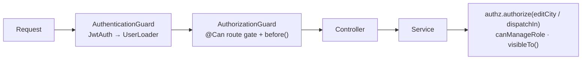

# Authorization

Implemented with `@nestjs/authorization` `^0.1.3`: a global guard that **denies by default**. Each handler must declare `@Can(Policy, ability)`, `@Can.Anyone()` or `@Public()`. Class-level and method-level `@Can` both apply (AND).

## Model: role × office

Every `User` has a `role` and an office (`officeLevel` + `districtId`/`cityId`). `UserLoader` (`backend/src/auth/user-loader.service.ts`) derives two fields on every request using `backend/src/auth/area.ts`:

| Office | `areaCityIds` | `dispatchCityId` (Radio Operators only) |
|---|---|---|
| REGIONAL | `null` (all NCR) | `null` |
| DISTRICT | all cities of the district | the district's city **if the district has exactly one** (FD1 Manila, FD5 Quezon City), else `null` |
| CITY | `[cityId]` | `cityId` |

Allowed office levels per role (`OFFICE_LEVELS`): SUPER_ADMIN and ADMIN → REGIONAL; OPERATIONS → DISTRICT or CITY; RADIO_OPERATOR → REGIONAL, DISTRICT or CITY.

## Abilities (`backend/src/auth/access.policy.ts`)

`before(user)`: returns `false` (deny) when `user.mustChangePassword`.

| Ability | Grants |
|---|---|
| `operate` | any signed-in user |
| `viewRunningCard` | SUPER_ADMIN, RADIO_OPERATOR (any office) |
| `editStations` | SUPER_ADMIN; OPERATIONS whose office runs a city (`officeCityId`: a city office, or the FD1/FD5 district office). Fire District II-IV and Regional Operations get 403 (route gate) |
| `editCity(cityId)` | SUPER_ADMIN; OPERATIONS whose `officeCityId === cityId` (record check) |
| `dispatch` | SUPER_ADMIN; RADIO_OPERATOR with a non-null `dispatchCityId` (route gate) |
| `dispatchIn(cityId)` | SUPER_ADMIN; RADIO_OPERATOR whose `dispatchCityId === cityId` (record check) |
| `manageUsers` | SUPER_ADMIN, ADMIN |
| `viewAuditLog` | SUPER_ADMIN, ADMIN |
| `manageSettings` | SUPER_ADMIN |

Additional checks outside the policy:
- `canManageRole` (`users.service.ts`): ADMIN cannot create or modify SUPER_ADMIN accounts.
- Self-protection: users cannot change their own role, disable themselves, or remove themselves.
- Incident visibility filter `visibleTo()` (`incidents.service.ts`).

## Permission matrix (as implemented)

| Action | SUPER_ADMIN | ADMIN | OPERATIONS (district / city) | RADIO_OPERATOR city, FD1/FD5 district | RADIO_OPERATOR FD2–4 district, regional |
|---|---|---|---|---|---|
| Read districts, barangays, stations, settings | ✓ | ✓ | ✓ | ✓ | ✓ |
| Preview running card | ✓ | — | — | ✓ | ✓ |
| Set first barangay pin | ✓ | ✓ | ✓ | ✓ | ✓ |
| Overwrite barangay pin | ✓ | — | own city (city office, FD1/FD5); FD II-IV: — | — | — |
| Create/edit stations, trucks, truck status | ✓ | — | own city (city office, FD1/FD5); FD II-IV: view only | — | — |
| List/view incidents | all | all | own area + responded/notified | own area + responded/notified | district area + responded/notified / all (regional) |
| Dispatch, raise, close | any city | — | — | own city only | — |
| Next-alarm preview | any | — | — | own city only | — |
| Manage users | all roles | all except SUPER_ADMIN | — | — | — |
| Audit log | ✓ | ✓ | — | — | — |
| Change settings | ✓ | — | — | — | — |

"Responded" means at least one unit's station is in the office's area; "notified" means a notification named a city in the area (e.g. its station was on the running card).

`officeCityId` (`area.ts`) is the one city an office runs: a city office's city, or the single city of FD1 (Manila) / FD5 (Quezon City). It decides who dispatches (Radio Operators) and who maintains stations, trucks and barangay pins (Operations). Fire District II-IV and Regional offices run no city: they view only.

Manila (FD1) and Quezon City (FD5) offices exist only at district level; migration `20261108100000_single_city_district_offices` moved any city-level accounts there (their area and dispatch city are unchanged).

The frontend hides the Running Card page from Admin and Operations; their home page is Incidents.

## Where each rule is enforced

**Notifications** (`NotificationsService.isFor` / `forUser`): an office receives and lists notifications whose `cityIds` share a city with its `areaCityIds`, with `units` cut to its own area; Regional accounts (`null` area) receive all, with all units. `IncidentsService.visibleTo()` also lets an office open incidents that notified it, so cities that are only on the running card can view the incident.

The frontend mirrors these rules in `frontend/src/auth/permissions.js` and in the `NAV` role lists only to hide UI; it is not a security boundary.
